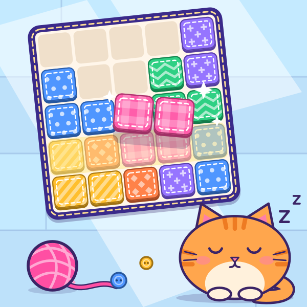
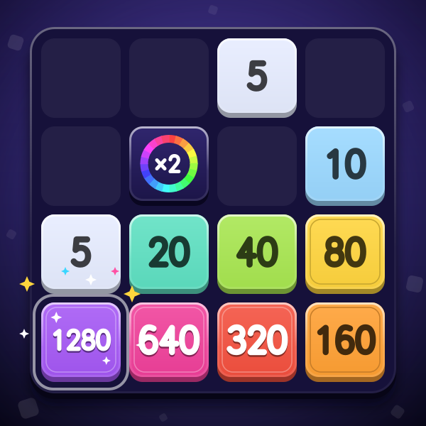
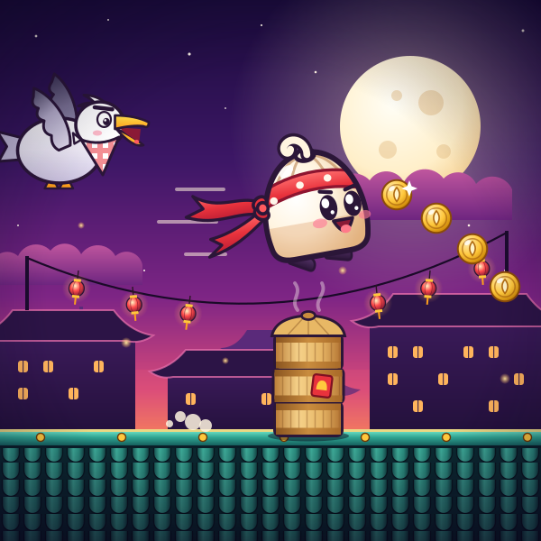
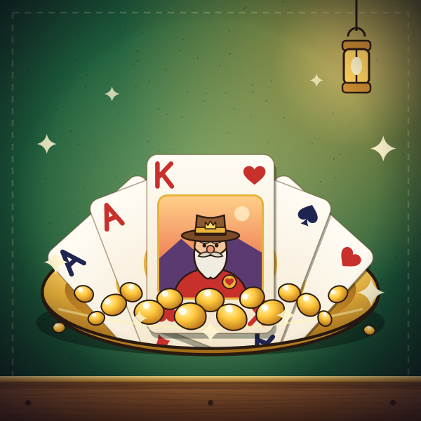
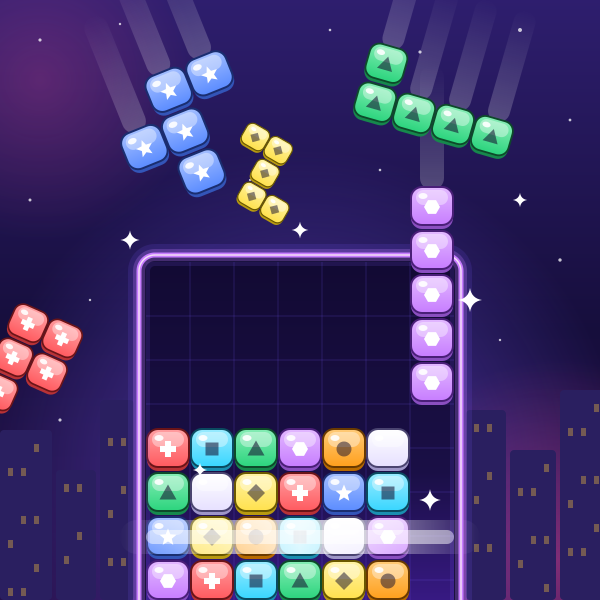
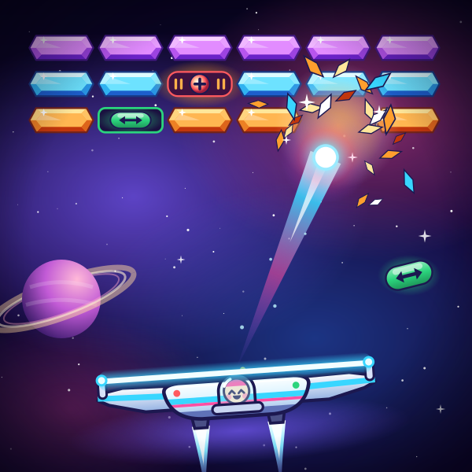
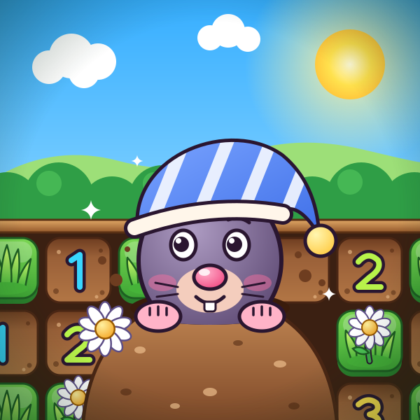
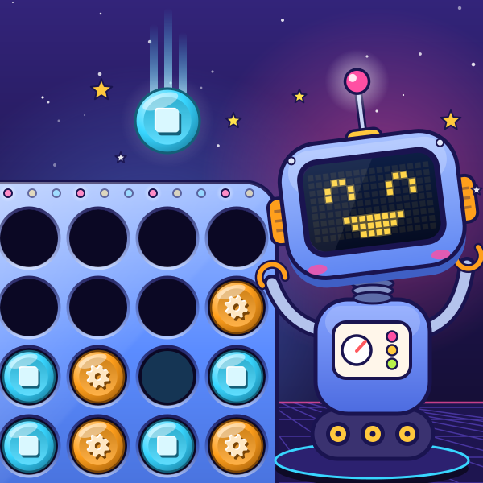
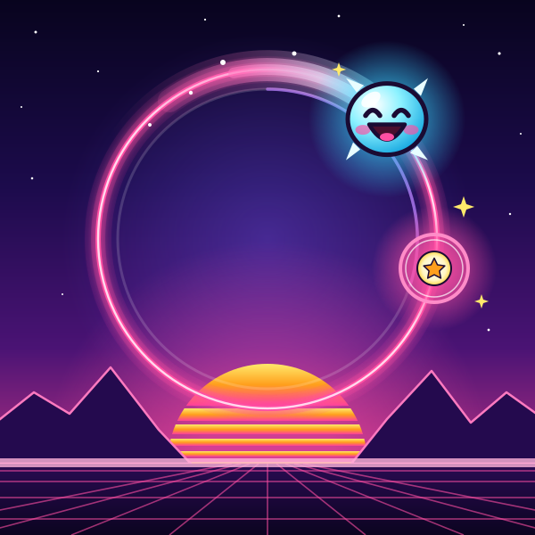

<div align="center">


# Pocketcade

**A whole arcade in your pocket.** Free browser games that start in a second on any device, with no downloads,
sign-ups, ads or tracking.


</div>

## The games

<table>
  <tr>
    <td align="center"><a href="packages/games/pebble-post"><br />Pebble Post</a></td>
    <td align="center"><a href="packages/games/pop-reef"><br />Pop Reef</a></td>
    <td align="center"><a href="packages/games/snugfit"><br />Snugfit</a></td>
    <td align="center"><a href="packages/games/hue-brew"><br />Hue Brew</a></td>
  </tr>
  <tr>
    <td align="center"><a href="packages/games/sumslide"><br />Sumslide</a></td>
    <td align="center"><a href="packages/games/sunset-sprint"><br />Sunset Sprint</a></td>
    <td align="center"><a href="packages/games/bao-bolt"><br />Bao Bolt</a></td>
    <td align="center"><a href="packages/games/sourdough"><br />Sourdough Solitaire</a></td>
  </tr>
  <tr>
    <td align="center"><a href="packages/games/pentafall"><br />Pentafall</a></td>
    <td align="center"><a href="packages/games/glowworm"><br />Glowworm</a></td>
    <td align="center"><a href="packages/games/comet-bounce"><br />Comet Bounce</a></td>
    <td align="center"><a href="packages/games/letterhop"><br />Letterhop</a></td>
  </tr>
  <tr>
    <td align="center"><a href="packages/games/molehills"><br />Molehills</a></td>
    <td align="center"><a href="packages/games/rowbot"><br />Rowbot</a></td>
    <td align="center"><a href="packages/games/starlap"><br />Starlap</a></td>
    <td align="center"><a href="packages/games/firefly-flip"><br />Firefly Flip</a></td>
  </tr>
</table>

Sixteen original games: arcade runners, a racer, a growing-worm chase, a comet-and-paddle game, a one-button timing
game, a bubble shooter, block and number puzzles, a colour-sort puzzle, a falling-block puzzle, a deduction puzzle, a daily word ladder,
solitaire, four in a row and a two-mode memory game. Each has its own art, synthesized sound, keyboard and touch controls (all but one also
take a mouse) and local high scores. Rules and art notes for every game are in [docs/games.md](docs/games.md).

## Highlights

- **Instant and private.** A static site with no server code. Saves, scores and settings stay in the browser; the
  pages load nothing from other sites and set no cookies.
- **One contract for every game.** Each game is a package that implements `Game` and talks to the page only through
  `HostAPI`, so the portal can pause, resume, fullscreen, mute and unmount any of them the same way, and a crash never
  takes the page down.
- **Fits any screen.** A game can declare a range of frame shapes; the portal picks the one that best fills the
  screen, wide on a desktop and tall on a phone, and the canvas stays sharp in fullscreen.
- **Small and fast.** Games load on demand. Phaser ships as one shared chunk that catalog pages never download, and CI
  fails if a page or game grows past its size budget.
- **Tested end to end.** Unit tests for every game's rules, a contract suite for every game in a real browser,
  Playwright tests of the built site, and a leak test that mounts and unmounts every game.

## Quick start

You need Node.js 26 and pnpm 12.18.0. The pnpm version is pinned in `package.json`, and pnpm downloads it if you have
a different version installed.

```bash
pnpm install
pnpm dev
```

The portal runs at http://localhost:3000. To try a single game on its own, with controls for frame size, pause and
mute, run the playground at http://localhost:5173:

```bash
pnpm --filter @pocketcade/playground dev
```

Contract tests and end-to-end tests run in Chromium. Install it once:

```bash
pnpm --filter @pocketcade/web exec playwright install chromium
```

## Commands

| Task                                                            | Command                                     |
| --------------------------------------------------------------- | ------------------------------------------- |
| Install dependencies (CI adds `--frozen-lockfile`)              | `pnpm install`                              |
| Portal dev server (localhost:3000)                              | `pnpm dev`                                  |
| Playground: any game on the real host (localhost:5173)          | `pnpm --filter @pocketcade/playground dev`  |
| Screenshot a game running in the playground                     | `node apps/playground/scripts/shot.ts <id>` |
| Build everything (the portal's static export: `apps/web/out`)   | `pnpm build`                                |
| Serve `apps/web/out` with `vercel.json` (127.0.0.1:4173)        | `pnpm serve:static`                         |
| Lint (Prettier, ESLint, generated data), typecheck, test, build | `pnpm verify`                               |
| Size budgets (after a build)                                    | `pnpm budgets`                              |
| End-to-end tests: portal and leak test (builds first)           | `pnpm e2e`                                  |
| Everything in `verify`, plus end-to-end tests                   | `pnpm check`                                |
| One package's tests, for example a game                         | `pnpm --filter @pocketcade/game-<id> test`  |
| Share images in `apps/web/public/og/` (commit them)             | `pnpm og`                                   |
| Format                                                          | `pnpm format`                               |

## Repository layout

```
apps/web           Next.js portal (static export), vercel.json, share-image script, Playwright e2e
apps/playground    Vite app that mounts any game on the real host; screenshot script and leak test
packages/sdk       The Game / HostAPI contract, storage and score rules, mock host and contract suite
packages/host      GameRunner and host services: storage, scores, audio, fullscreen, error attribution
packages/toolkit   Shared game code: input, synthesized sound, saves, overlays; Phaser and DOM adapters
packages/games/*   The 16 games, each with game.md, cover art, unit tests and the contract suite
packages/config    Shared tsconfig, ESLint and Prettier config
tools/             Registry generator, word-list builder, post-build step, static server, size budgets
docs/              Architecture, game-making guide, design system, games reference, project overview
```

## Adding a game

1. Create `packages/games/<id>/` by copying a game of a similar kind: `src/meta.ts` (`id` is the folder name),
   `src/index.ts`, `game.md` (listing, controls, FAQ, cover alt text), `media/cover.svg` (600 × 600, at most 40 KB),
   unit tests and `test/contract.test.ts`.
2. Add `"@pocketcade/game-<id>": "workspace:*"` to the dependencies of `apps/web` and `apps/playground`, then run
   `pnpm install`.
3. Add the id to `gameOrder` in `apps/web/src/games/catalog.ts`.
4. Run `pnpm og` and commit the new `apps/web/public/og/<id>.jpg`.

The registry, the listing and the cover reach the portal automatically on the next build, and the size budget
applies to the new game without any extra step. The full guide is [docs/making-games.md](docs/making-games.md).

## Deploying to Vercel

The repository deploys as one Vercel project, set up once in the dashboard:

| Setting                            | Value                                                                                                   |
| ---------------------------------- | ------------------------------------------------------------------------------------------------------- |
| Root Directory                     | `apps/web`, with "Include files outside the Root Directory" on                                          |
| Framework preset                   | Next.js                                                                                                 |
| Build Command                      | `turbo build`. Set it explicitly: the app's own `build` script does not run `gen-registry`, so it fails |
| Install Command, Output Directory  | Defaults (`pnpm install` at the repository root; the static export in `apps/web/out`)                   |
| Node.js                            | 26.x (matches `engines.node`)                                                                           |
| Environment variables (all)        | `ENABLE_EXPERIMENTAL_COREPACK=1`, `NEXT_TELEMETRY_DISABLED=1`, `TURBO_TELEMETRY_DISABLED=1`             |
| Deployment Protection              | Vercel Authentication off, so previews are public                                                       |
| Analytics, Speed Insights, Toolbar | Off: the site has no analytics or tracking and loads nothing but its own files                          |

Every environment variable the site reads is optional and non-secret; see [.env.example](.env.example). Check the first
deployment:

- The build log uses pnpm 12.18.0.
- The deployment lists no Functions, and `/version.json` shows the commit.
- `apps/web/vercel.json` holds every header, including `X-Robots-Tag: noindex` on every path. Remove that header when
  the site should appear in search results.
- `/robots.txt` on a preview says `Disallow: /`. On production, `/sitemap.xml` and each page's canonical link use
  `https://<project>.vercel.app`. Once the site has its own domain, set `NEXT_PUBLIC_SITE_URL` in the project.

The playground can be a second, optional project: Root Directory `apps/playground`, preset Vite, output `dist`, with
the same Node.js version and variables.

## Documentation

| Document                                                 | What it covers                                                                       |
| -------------------------------------------------------- | ------------------------------------------------------------------------------------ |
| [docs/architecture.md](docs/architecture.md)             | How Pocketcade is built: packages, contract, host, toolkit, portal, build and checks |
| [docs/making-games.md](docs/making-games.md)             | Writing a game: package anatomy, toolkit, flexible frames, crisp art, checks         |
| [docs/design-system.md](docs/design-system.md)           | Colours, type, components and each game's art direction                              |
| [docs/games.md](docs/games.md)                           | Each game's rules, controls and art                                                  |
| [docs/project-overview.html](docs/project-overview.html) | A one-page illustrated tour of the project for newcomers                             |
| [CONTRIBUTING.md](CONTRIBUTING.md)                       | Setup, the checks to run before a pull request, and the house rules                  |
| [ASSETS.md](ASSETS.md)                                   | Third-party fonts, word lists and libraries, with their licences                     |

## License

Code is under the [MIT License](LICENSE). Original art, audio and text are under [CC BY 4.0](LICENSE-ASSETS), credit
"Pocketcade contributors". Third-party fonts and word lists keep their own licences and are listed in
[ASSETS.md](ASSETS.md).
