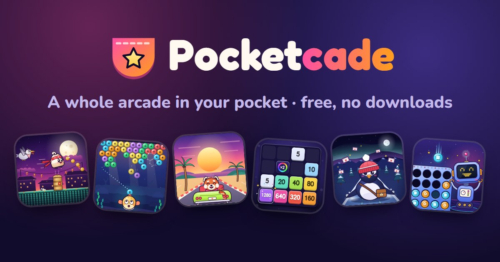
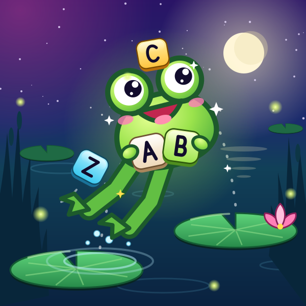
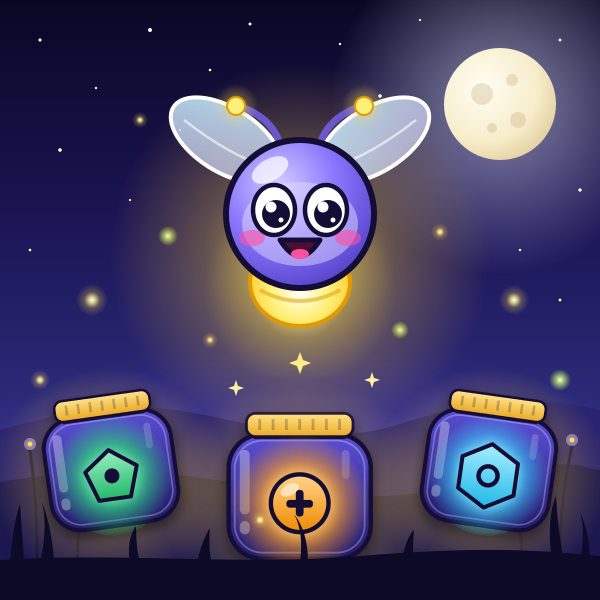
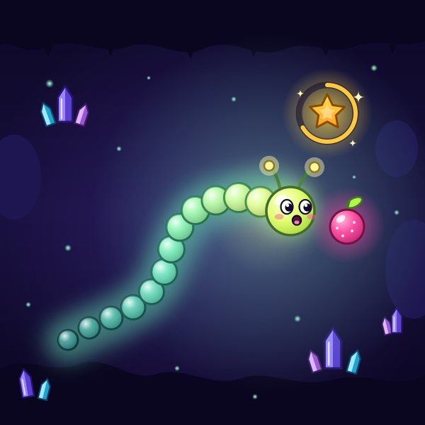
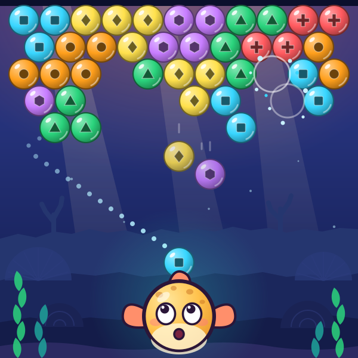

<div align="center">


# Pocketcade

**A whole arcade in your pocket.** Free browser games that start in a second on any device,
with no downloads, sign-ups, ads or tracking.




</div>

## The games

<table>
  <tr>
    <td align="center"><a href="packages/games/sumslide"><br />Sumslide</a></td>
    <td align="center"><a href="packages/games/letterhop"><br />Letterhop</a></td>
    <td align="center"><a href="packages/games/bao-bolt"><br />Bao Bolt</a></td>
    <td align="center"><a href="packages/games/comet-crush"><br />Comet Crush</a></td>
    <td align="center"><a href="packages/games/firefly-flip"><br />Firefly Flip</a></td>
    <td align="center"><a href="packages/games/on-the-dot"><br />On the Dot</a></td>
    <td align="center"><a href="packages/games/pentafall"><br />Pentafall</a></td>
  </tr>
  <tr>
    <td align="center"><a href="packages/games/rowdy"><br />Rowdy</a></td>
    <td align="center"><a href="packages/games/sourdough"><br />Sourdough</a></td>
    <td align="center"><a href="packages/games/molehills"><br />Molehills</a></td>
    <td align="center"><a href="packages/games/glowworm"><br />Glowworm</a></td>
    <td align="center"><a href="packages/games/pop-reef"><br />Pop Reef</a></td>
    <td align="center"><a href="packages/games/sunset-sprint"><br />Sunset Sprint</a></td>
    <td align="center"><a href="packages/games/pebble-post"><br />Pebble Post</a></td>
  </tr>
</table>

Puzzles, arcade runners, a racer, a bubble shooter, a word ladder, solitaire and four-in-a-row: 14 original games,
each with its own art, synthesized sound, touch and keyboard controls (most also take a mouse) and local high
scores.

## Highlights

- **Instant and private.** A static site with no server code. Saves, scores and settings stay in the browser; the
  pages load nothing from other sites and set no cookies.
- **One contract for every game.** Each game is a package that implements `Game` / `HostAPI`, so the portal can
  pause, resume, fullscreen, mute and unmount any of them the same way, and a crash never takes the page down.
- **Small and fast.** Games load on demand; Phaser ships as one shared chunk that catalog pages never download, and
  CI fails if a page or game grows past its size budget.
- **Tested end to end.** Unit tests for every game's simulation, a contract suite against the real host, Playwright
  across five browser profiles, and leak tests that mount and unmount games 20 times.

## Quick start

Needs Node.js 26.x and pnpm 12.18.0 (pnpm 10+ switches to it automatically from `packageManager`).

```bash
pnpm install
pnpm dev
```

The portal runs at http://localhost:3000. To see the production build as Vercel serves it:

```bash
pnpm turbo run build && pnpm serve:static
```

## Commands

| Task                                                   | Command                                                                         |
| ------------------------------------------------------ | ------------------------------------------------------------------------------- |
| Install (CI: `--frozen-lockfile`)                      | `pnpm install`                                                                  |
| Portal dev server (localhost:3000)                     | `pnpm dev`                                                                      |
| Playground: any game on the real host (localhost:5173) | `pnpm --filter @pocketcade/playground dev`                                      |
| Build the static export (`apps/web/out`)               | `pnpm turbo run build`                                                          |
| Serve `out/` with `vercel.json` (127.0.0.1:4173)       | `pnpm serve:static`                                                             |
| Lint (incl. Prettier), typecheck, unit tests, build    | `pnpm verify`                                                                   |
| Everything, plus end-to-end tests                      | `pnpm check`                                                                    |
| Playwright browsers (once, before e2e)                 | `pnpm --filter @pocketcade/web exec playwright install chromium firefox webkit` |
| Bundle-size budgets (after a build)                    | `pnpm budgets`                                                                  |
| Share images in `apps/web/public/og/` (commit them)    | `pnpm og`                                                                       |
| Format                                                 | `pnpm format`                                                                   |

## How it is built

```
apps/web           Next.js portal (static export), vercel.json, Playwright e2e
apps/playground    Vite app that mounts any game on the real host; leak and crash tests
packages/sdk       The Game / HostAPI contract, storage and score rules, contract test suite
packages/host      GameRunner and host services: storage, scores, audio, fullscreen, errors
packages/toolkit   Shared game code: loop, input, synthesized SFX, saves, overlays; Phaser and DOM adapters
packages/games/*   The 14 games, each with game.md, cover art, unit tests and the contract suite
packages/config    Shared tsconfig, ESLint and Prettier config
tools/             Registry generator, post-build step, size budgets, workspace and workflow checks
```

The full picture (contract, host, toolkit, portal routes, build pipeline and quality gates) is in
[docs/design.md](docs/design.md).

## Adding a game

1. Create `packages/games/<id>/` (copy a similar game): `src/meta.ts` (`id` = folder name), `src/index.ts`,
   `game.md` (controls, FAQ, cover alt text), `media/cover.svg` (600×600, ≤ 40 KB), unit tests and
   `test/contract.test.ts`.
2. Add `"@pocketcade/game-<id>": "workspace:*"` to the `apps/web` and `apps/playground` dependencies, then
   `pnpm install`.
3. Add its listing (title, tagline, category, accent, blurb) to `apps/web/src/games/catalog.ts`; the typecheck fails
   until you do. `tools/gen-registry` picks up the loader, meta, cover and `game.md` details automatically.
4. Run `pnpm og` and commit the new `apps/web/public/og/<id>.jpg` (the build fails without it).
5. Add a marker row to `GAME_MARKERS` in `tools/check-budgets.ts` so its bundle size is checked.

## Deploying to Vercel

The repo deploys as one Vercel project, set up once in the dashboard:

| Setting                            | Value                                                                                          |
| ---------------------------------- | ---------------------------------------------------------------------------------------------- |
| Root Directory                     | `apps/web`, with "Include files outside the Root Directory" on                                 |
| Framework preset                   | Next.js                                                                                        |
| Build Command                      | `turbo build` — set it explicitly: plain `next build` skips `gen-registry`, so the build fails |
| Install / Output Directory         | Defaults (`pnpm install` at the repo root; the static export in `apps/web/out`)                |
| Node.js                            | 26.x (matches `engines.node`)                                                                  |
| Environment variables (all)        | `ENABLE_EXPERIMENTAL_COREPACK=1`, `NEXT_TELEMETRY_DISABLED=1`, `TURBO_TELEMETRY_DISABLED=1`    |
| Deployment Protection              | Vercel Authentication off, so previews are public                                              |
| Analytics, Speed Insights, Toolbar | Off (the site loads nothing but its own files)                                                 |

Every environment variable is optional and non-secret; see [.env.example](.env.example). Check the first preview
deployment:

- The build log uses pnpm 12.18.0. Vercel lists pnpm 12, but Corepack with pnpm 12 is not documented yet.
- The deployment lists no Functions, and `/version.json` shows the commit.
- `apps/web/vercel.json` holds every header. It sends `X-Robots-Tag: noindex` on purpose until launch.
- `/robots.txt` on a preview says `Disallow: /`. On production, `/sitemap.xml` and each page's canonical link use
  `https://<project>.vercel.app`. Once the site has its own domain, set `NEXT_PUBLIC_SITE_URL` in the project.

The playground can be a second, optional project: Root Directory `apps/playground`, preset Vite, output `dist`, with
the same Node.js and variables.

## Documentation

| Document                                       | What it covers                                                          |
| ---------------------------------------------- | ----------------------------------------------------------------------- |
| [docs/design.md](docs/design.md)               | How Pocketcade is built: the reference for the code                     |
| [docs/design-system.md](docs/design-system.md) | Colours, type, components and each game's art direction                 |
| [docs/games-notes.md](docs/games-notes.md)     | Each game's rules and art, plus every departure from the original specs |
| [docs/research.md](docs/research.md)           | The browser-game market research behind the genre choices               |

## License

Code is [MIT](LICENSE). Original art, audio and text are [CC BY 4.0](LICENSE-ASSETS), credit "Pocketcade
contributors". Third-party fonts and word lists are listed in [ASSETS.md](ASSETS.md).
