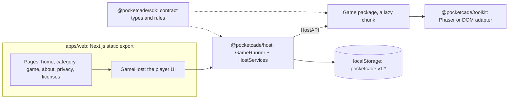
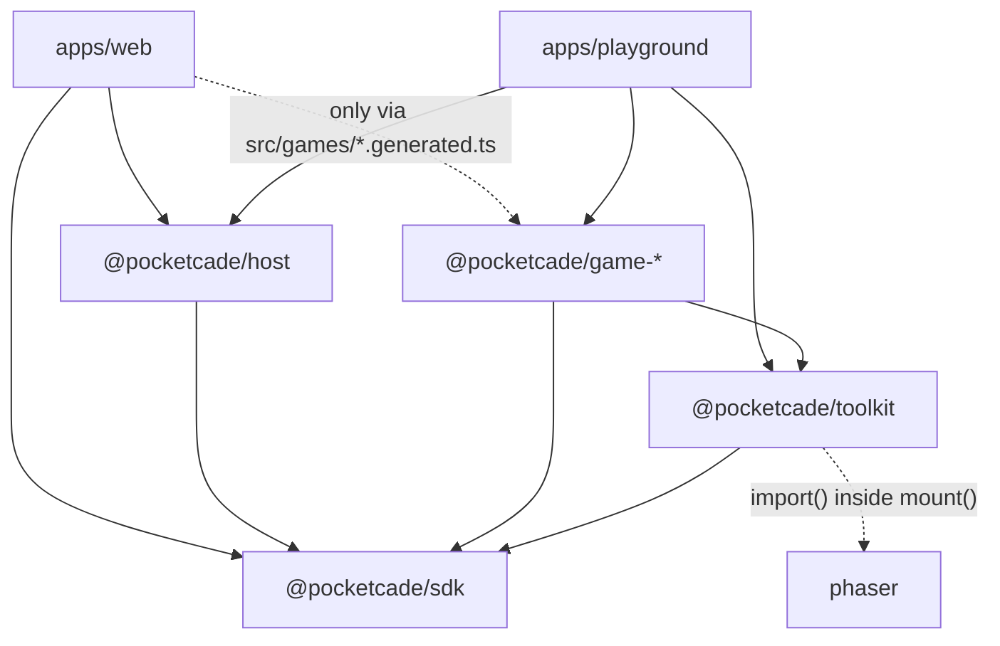
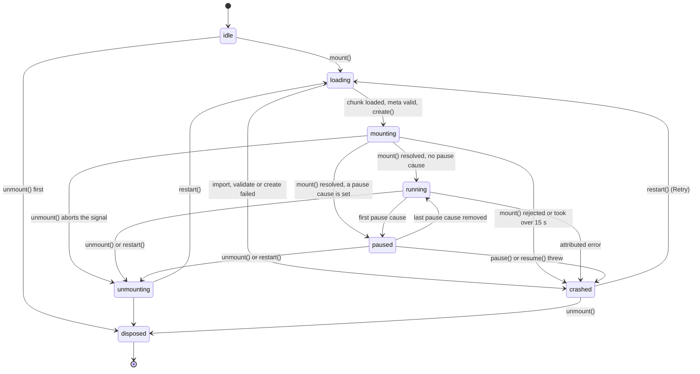
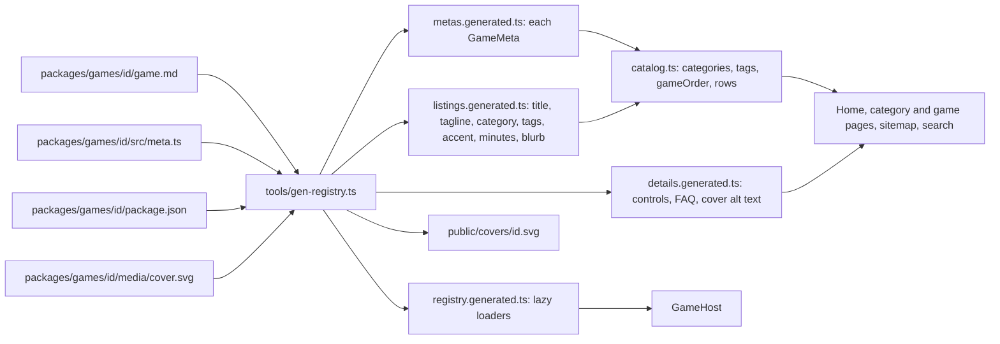
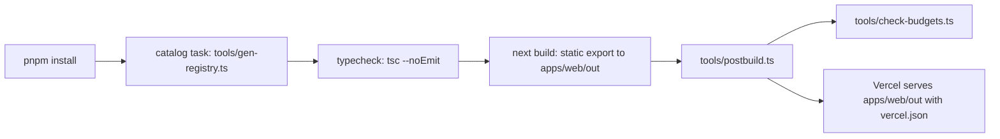

# Pocketcade architecture

How Pocketcade is built: the packages and what each may depend on, the contract every game implements, the host that
runs games, the toolkit games are written with, the portal, the build and the checks that guard it. This is the
reference for the code. The visual language is in [design-system.md](design-system.md), the guide to writing a game
is [making-games.md](making-games.md), and each game's rules are in [games.md](games.md).

## At a glance

| Area    | Choice                                                                                                     |
| ------- | ---------------------------------------------------------------------------------------------------------- |
| Product | 15 free browser games; no accounts, ads, analytics, cookies or third-party requests                        |
| Portal  | Next.js 16.4.5 App Router and React 19.3.1, built as a static export (`output: 'export'`, trailing slashes) |
| Games   | Workspace packages behind one contract (`Game` / `HostAPI`); 14 on Phaser 4.2.1, 1 on plain DOM            |
| Data    | Saves, local top-10 boards, settings and play history in `localStorage`, on the device only                |
| Hosting | One Vercel project serving `apps/web/out`; every header in `apps/web/vercel.json`; no server functions     |
| Tooling | pnpm 12.18.0 workspace, Turborepo 2.11.10, Node.js 26, TypeScript 7.0.2, Vitest 5.1.0, Playwright 1.65.0   |

## Repository

| Path                  | Package                  | Role                                                                                                       |
| --------------------- | ------------------------ | ---------------------------------------------------------------------------------------------------------- |
| `packages/sdk`        | `@pocketcade/sdk`        | Contract types, `defineGame`, `validateMeta`, `aspectRange`; storage and score rules (`./rules`); mock host and contract suite (`./testing`) |
| `packages/host`       | `@pocketcade/host`       | `createGameRunner`, `createHostServices` (storage, scores, audio, fullscreen, error attribution); leak probe (`./testing`) |
| `packages/toolkit`    | `@pocketcade/toolkit`    | Shared game code: input, sound synthesis, saves, RNG, overlays, attract mode, tokens, art helpers; `./phaser` and `./dom` adapters |
| `packages/games/<id>` | `@pocketcade/game-<id>`  | One game: `game.md`, `media/cover.svg`, `src/meta.ts`, `src/index.ts`, unit and contract tests            |
| `packages/config`     | `@pocketcade/config`     | Shared `tsconfig.base.json`, ESLint flat config and Prettier config                                         |
| `apps/web`            | `@pocketcade/web`        | The portal, `vercel.json`, the share-image script and the portal e2e tests                                  |
| `apps/playground`     | `@pocketcade/playground` | Vite 8.3.6 app that mounts any game on the real host; the screenshot script and the leak test              |
| `tools/`              | (root scripts)           | `gen-registry`, `gen-word-ladder`, `postbuild`, `serve-static`, `check-budgets`, run with plain `node`      |

The sdk, host, toolkit and game packages are TypeScript source with no build step of their own; Next.js and Vite
compile them where they are used, and Node.js runs the `.ts` scripts in `tools/` directly.

### What each package may depend on

The import rules live in `packages/config/eslint.js`; each package's ESLint run (part of `pnpm verify`) fails when one
is broken.

| Package         | May import                                                                                                  |
| --------------- | ----------------------------------------------------------------------------------------------------------- |
| sdk             | Nothing: no other `@pocketcade/*` package, no Phaser, no React or Next                                      |
| host            | `@pocketcade/sdk` only                                                                                      |
| toolkit         | `@pocketcade/sdk`; only `src/phaser/**` refers to Phaser, as types, and loads it with `import()` inside `mount()` |
| a game          | `@pocketcade/sdk` (not `./rules`), `@pocketcade/toolkit`, and Phaser types; never the host or another game |
| apps/web        | sdk and host; game packages only through the generated files in `src/games/`; never Phaser or the toolkit  |
| apps/playground | Anything except React and Next                                                                              |

Game source also runs inside a sandbox enforced by ESLint (tested in `tools/test/eslint-game.test.ts`): no
`localStorage`, `sessionStorage`, `indexedDB`, `cookieStore` or `document.cookie` (use `host.storage`); no `fetch`,
`XMLHttpRequest`, `WebSocket` or `EventSource`; no global `addEventListener`; `document` only to create elements; no
access through `window`, `globalThis` or `self`; no module-level `let` or `var`; and never `context.close()` on the
shared `AudioContext`.

Dependencies use exact versions. Versions shared by several packages are declared once in the `catalog:` section of
`pnpm-workspace.yaml`, and `savePrefix: ''` makes `pnpm add` save exact versions.

## The game contract

A game package default-exports a `GameDefinition` (`packages/sdk/src/index.ts`): a static `meta` and a `create()` that
returns a fresh `Game` for every mount. Nothing mutable lives at module level, and importing the module does no work.
`defineGame` validates the meta in development builds and throws `InvalidGameMeta` when it is wrong.

### `GameMeta`

| Field               | Meaning                                                                                                 |
| ------------------- | ------------------------------------------------------------------------------------------------------- |
| `id`                | Kebab-case slug, up to 32 characters; equals the folder name and the package suffix (`@pocketcade/game-<id>`) |
| `apiVersion`        | Contract version, `1`                                                                                   |
| `version`           | The game package's SemVer                                                                               |
| `inputs`            | One or more of `keyboard`, `pointer`, `touch`                                                           |
| `orientation`       | `landscape`, `portrait` or `any`                                                                        |
| `aspectRatio`       | A ratio (width / height), a `{ min, max }` range, or `'fill'`; ratios lie in 0.25 to 4 (see [Flexible frames](#flexible-frames)) |
| `minSize`           | Smallest playable frame in CSS px; below it the host pauses the game and shows a notice                 |
| `saveSchemaVersion` | Integer from 1, stamped into every save envelope                                                        |
| `leaderboards`      | Up to 8 local boards: `id`, `label` (1 to 40 characters), `order` (`desc` or `asc`), `format` (`integer`, `duration_ms`, `moves`); may be empty |
| `pauseKeys`         | Optional `KeyboardEvent.code` values the game uses to toggle its own pause menu; default `['Escape']`   |

### `Game`

| Method                                        | Contract                                                                                         |
| --------------------------------------------- | ------------------------------------------------------------------------------------------------ |
| `mount(container, host, { signal, size, launch })` | Resolves when playable. Honours `signal` (the host aborts on fast navigation). `launch` is `play`, `restart` or `attract` (a self-playing demo: no input, no storage writes, no scores) |
| `pause(reason)`, `resume()`                   | Idempotent; only the host calls them                                                             |
| `unmount()`                                   | Releases every loop, listener, timer, worker, audio node, WebGL context and DOM node the game created |

### `HostAPI`

| Member                | What a game gets                                                                                       |
| --------------------- | ------------------------------------------------------------------------------------------------------ |
| `apiVersion`, `capabilities` | Contract version; the set of available services (`storage`, `scores`, `fullscreen`, `audio`)    |
| `env`                 | Locale, reduced motion, mute at mount, primary input, local `dailyKey` (`YYYY-MM-DD`), whether storage persists, dev flag |
| `storage`             | Async `get`, `set`, `remove`, `keys` per game; never throws, returns a result instead                  |
| `scores`              | `submit({ board, value, meta? })` and `top(board)` on local top-10 boards; the portal, never the game, asks for initials |
| `display`             | `requestFullscreen()` (from an input handler) and `exitFullscreen()`                                   |
| `audio`               | The shared `AudioContext` and a master output node; games must not close the context                  |
| `gameplay`            | `start()`, `stop(reason)` and `loading(progress)` signals for the player UI                            |
| `on(event, cb)`       | `resize`, `mute`, `fullscreenchange`, `inputchange`, `dailyrollover`                                   |
| `reportError(error)`  | Records a non-fatal error; shown in the crash card details                                             |

Storage rules (`packages/sdk/src/rules`, shared by the real host and the mock host): keys match
`/^[a-z0-9][a-z0-9._-]{0,63}$/`, a value is at most 64 KiB serialized, a game at most 256 KiB in total. Every value is
stored in an envelope `{ v, savedAt, data }`. In attract mode storage and scores are read-only. When `localStorage` is
unavailable the host falls back to memory for the page's lifetime and `env.storagePersistent` is `false`.

| `localStorage` key                     | Holds                                                               |
| -------------------------------------- | ------------------------------------------------------------------- |
| `pocketcade:v1:g:<game>:<key>`         | A game's saves; the toolkit reserves `tk.*` keys (`tk.prefs`, `tk.howto`) |
| `pocketcade:v1:lb:<game>:<board>`      | One local top-10 board                                              |
| `pocketcade:v1:p:<key>`                | Portal data: `settings` (mute, last initials) and `history` (plays and last-played time per game) |

The portal also keeps one timestamp in `sessionStorage` (`pocketcade:v1:p:update-prompted-at`) so the update prompt
appears at most once every five minutes per tab.

## The host

`@pocketcade/host` mounts one game into a player frame. `createHostServices` is created once per document and holds
storage, scores, the shared audio, window-error attribution and a document-wide slot that lets only one game run at
a time. `createGameRunner` drives one game through the contract and reports what happens as `RunnerEvent`s (state,
progress, pause changes, notices, gameplay, ranked scores, fullscreen changes, diagnostics, crashes).

### Runner states

Timeouts: `mount()` must resolve within 15 s (`MountTimeout`); `unmount()` gets 2 s, after which the runner removes
the container anyway and logs a possible leak; an aborted mount gets 2 s to settle. `loading` also covers the wait for
the document-wide slot.

### Pause causes

The runner keeps a set of causes. The game is paused while any cause is present and resumed when the last one
clears; it sees `pause(reason)` once per new reason.

| Reason       | Set when                                                                        | Cleared by                         |
| ------------ | ------------------------------------------------------------------------------- | ---------------------------------- |
| `visibility` | The tab is hidden (`visibilitychange`, `pagehide`)                              | The player, from the resume overlay |
| `blur`       | The window loses focus while visible                                            | The player, from the resume overlay |
| `offscreen`  | Less than 50 % of the frame is visible (`IntersectionObserver`)                 | Scrolling the frame back into view |
| `overlay`    | The portal opens a dialog over the game (leaderboard sheet, restart confirmation) | Closing the dialog               |
| `host`       | The device needs rotating, the frame is below `minSize`, or the player left fullscreen | Rotating or enlarging; leaving fullscreen goes through the resume overlay |
| `user`       | Reserved in the contract; the portal does not set it                            |                                    |

While paused, the shared `AudioContext` is suspended. The overlay accepts a click, a tap or any key except Tab,
modifiers and Escape, and resumes audio inside that gesture.

### Errors

| Error name            | Cause                                                       | Player's main action |
| --------------------- | ----------------------------------------------------------- | -------------------- |
| `ChunkLoadError`      | The game's code failed to load                              | Retry, or Reload when a newer build is live |
| `ApiVersionMismatch`  | The game was built for another contract version             | Reload               |
| `InvalidGameMeta`     | `validateMeta` found problems                               | Report               |
| `MountTimeout`        | `mount()` took over 15 s                                    | Restart              |
| `GameRuntimeError`    | A window `error` attributed to the running game             | Restart              |
| `LifecycleError`      | `create()`, `mount()`, `pause()` or `resume()` threw        | Restart              |

A window `error` belongs to the mounted game only if the error carries the toolkit's marker
(`Symbol.for('pocketcade.gameId')`) or comes from a script the game loaded; an attributed `unhandledrejection` is
recorded as a non-fatal diagnostic. The toolkit freezes a game and rethrows once on its first fatal error, and treats
listener errors as fatal after three within one second, so a broken frame never floods the page.

The portal turns a crash into the crash card: Retry, Copy details and, when the repository URL is known, Report a bug
(a prefilled GitHub issue of at most 8,000 characters). A third crash of the same game within 60 s is flagged as a
crash loop. When a chunk fails to load and `/version.json` reports a different build id, the portal shows an update
card with Reload instead. A render error in the player UI itself is caught by `PlayerErrorBoundary`, which replaces
the player with a "Reload page" card and leaves the rest of the page working.

### Audio

One `AudioContext` per document, created on demand. Each mount gets a fresh master `GainNode`, silent in attract
mode or while muted. The Play click resumes the context synchronously, inside the gesture. The host suspends it
whenever the game is paused or muted, and its "latest intent wins" queue undoes resumes by anyone else. A game that
calls `close()` on the context gets a `ContractViolation` error in development and a warning in production. Mute is a
portal setting saved on the device and applied to every game.

### Fullscreen

The player element (the frame plus the portal's overlays) goes fullscreen with the native Fullscreen API when it is
available and the page is not an installed standalone app; otherwise the host uses pseudo-fullscreen: a fixed,
full-viewport stage padded by the safe-area insets, with page scrolling locked and the rest of the page made inert.
In native fullscreen the host tries to lock the orientation for games that are not `any`. On a phone (coarse
pointer, viewport under 768 px) Play enters fullscreen automatically. In pseudo-fullscreen Escape exits; a game that
uses Escape for its own pause menu gets the first press, the player sees "Press Esc again to exit full screen", and a
second press within a second exits. Leaving fullscreen by the player's choice pauses the game behind the resume
overlay.

### Other host duties

- **Notices**: on a touch-primary device whose orientation does not match `meta.orientation`, the host pauses and
  asks the player to rotate; when the frame is smaller than `meta.minSize` it pauses and asks for a larger window.
- **Resize**: frame size and device-pixel-ratio changes reach the game as `resize` events (once per frame at most).
- **Input**: while a game runs, arrow keys and Space do not scroll the page; a change of input kind (keyboard, mouse,
  touch) reaches the game as `inputchange`, at most once a second.
- **Daily key**: a timer at local midnight and a check every minute emit `dailyrollover` when the date changes.
- **Focus**: after mount the host focuses the game's stage unless the player has moved focus elsewhere.

## The toolkit

Games are written with `@pocketcade/toolkit`. Its adapters implement the whole `Game` contract, so a game supplies
only its meta, its scenes or DOM code, and a little configuration.

| Module                       | What it gives every game                                                                        |
| ---------------------------- | ----------------------------------------------------------------------------------------------- |
| `context` (`tk`)             | The per-mount `TkContext`: live `env`, `layout`, `input`, `sfx`, `ui`, `rng`, `motion`, `run` (start and stop signals), `attract`, `createSave`, `on(event)` and error reporting |
| `input`                      | Keyboard actions by `KeyboardEvent.code`, pointer taps, swipes and drags in design units, an input gate, virtual input for attract |
| `sfx`                        | Sound effects synthesized from parameters and rendered to buffers at mount; no audio files      |
| `save`                       | Versioned saves over `host.storage` with validation, migrations and a `.bak` copy of anything unreadable |
| `rng`                        | Seeded sfc32 generator with identical output in every JavaScript engine; attract uses a fixed seed |
| `loop`                       | Fixed 60 Hz update with one render per frame and at most 5 catch-up steps (DOM games)           |
| `attract`                    | Scripted virtual input per 60 Hz step for the self-playing demo                                 |
| `ui/overlays`                | How-to card, pause menu (with a per-game "Game sound" switch), game-over dialog, toasts and the pause button, in their own shadow root |
| `tokens`, `art`, `util`      | Colour, type, spacing and motion tokens; Canvas 2D art helpers and brand-font loading; strings and score formatting |
| `./phaser`                   | `definePhaserGame`: lazy Phaser import, `kit.Scene`, `kit.text`, `kit.textures.canvas`, `kit.fps.burst`, and the game-feel helpers in `phaser/fx.ts` |
| `./dom`                      | `defineDomGame` for engine-less games: an open shadow root with scoped styles, pausable timers, `raf`, `loop` and a live region |

The Phaser adapter mounts in this order: build the DOM root, create the `TkContext`, read the sound preference,
`import('phaser')` (one shared chunk), render the sound bank, wait up to 300 ms for the host to start the audio
context, wait up to 800 ms for the brand fonts, create the `Phaser.Game`, wait for the boot scene, then focus the
stage and show the how-to card on a first play. Turn-based games run at 30 fps and use `kit.fps.burst()` for 60 fps
animation; realtime games run on every animation frame. `phaser/hardening.ts` works around the Phaser 4.2.1 behaviour that would
otherwise leak window listeners, focus handlers or whole games after `destroy()`.

## Flexible frames

`GameMeta.aspectRatio` takes three forms:

| Form            | Example                        | Frame the portal gives the game                                          |
| --------------- | ------------------------------ | ------------------------------------------------------------------------ |
| A number        | `1`                            | Exactly that shape                                                       |
| A range         | `{ min: 9 / 16, max: 16 / 9 }` | The shape inside the range that fills the most of the available space    |
| `'fill'`        | `'fill'`                       | The whole available area, any shape                                      |

`aspectRange()` turns each form into `{ min, max }` (or `null` for `'fill'`). The portal sizes the player in pure CSS
(`.player` in `apps/web/src/app/globals.css`), so it has its final size at first paint: `GameHost` sets `--ar-min`
and `--ar-max`, and the player takes `min(W, H × max)` by `min(H, W / min)` of the available width `W` and height
`H`. A `'fill'` game uses the class `player-fill` and the whole area. In fullscreen the frame is letterboxed inside
the screen with container-query units by the same rule.

The Phaser adapter keeps a fixed **design area** (`config.designSize`), whose shape must lie inside the range. When
the frame is wider or taller than the design area, the camera shows a larger **view** around it:

- `tk.layout.view` is the visible rectangle in design units; its `x` or `y` is negative when the view extends past
  the design area.
- `tk.layout.bleed` is the largest overhang the range allows on each side: `(designHeight × max − designWidth) / 2`
  horizontally and `(designWidth / min − designHeight) / 2` vertically.
- Gameplay stays inside the design area; scenery covers the bleed. `backdrop()` draws past the edges for this.

The canvas is rendered at a **render scale** of design units to canvas pixels: the larger of the scale that fits the
current frame and the scale that fits the whole screen (fullscreen), times the device pixel ratio, clamped to 0.25
to `maxRenderScale` (default 2). Textures are drawn once per mount at that scale, so a game stays sharp when the
player goes fullscreen. A DOM game gets the frame in CSS px and lays itself out.

## The portal

### Routes

| Route                                          | Content                                                                                      |
| ---------------------------------------------- | -------------------------------------------------------------------------------------------- |
| `/`                                            | Hero (the first game in `gameOrder`), Continue playing (on-device history), Top picks, categories, mood rows (Quick five, Brain workout, Unwind), all games |
| `/category/<id>/`                              | The category's games, then a rail from the other categories                                  |
| `/games/<id>/`                                 | Player, About, How to play (controls for the game's inputs), Questions, More like this       |
| `/about/`, `/privacy/`, `/licenses/`           | Static pages; Licenses reads the third-party table from `ASSETS.md` at build time            |
| `/sitemap.xml`, `/robots.txt`, `/version.json` | Static route handlers                                                                        |
| Any other path                                 | The 404 page, with four top picks; `noindex`                                                 |

Categories are Arcade, Puzzle, Word, Cards & Board and Brain. The header has category links, a search combobox that
filters the catalog in the browser, and the mute button.

### Catalog data flow

Each game's listing has one source: its `game.md`. The front matter holds `title`, `tagline`, `category`, `tags`,
`accent`, `minutes`, `coverAlt`, `controls` and `faq`; the text after it is the blurb. `tools/gen-registry.ts` reads
every game folder and writes four files under `apps/web/src/games/` (git-ignored) and copies the covers.

`catalog.ts` adds only what the portal knows: the categories, tag labels, the editorial `gameOrder`, the home-page
rows and the "More like this" ranking. Every list on the site follows `gameOrder`. The generator fails when a game's
package name is not `@pocketcade/game-<id>`, when it is not a `workspace:*` dependency of `apps/web`, when its cover
or share image is missing, or when `game.md` lacks a field. Listing types come from `catalog.ts`, so an unknown
category or tag fails the typecheck. `metas.generated.ts` imports only each package's `./meta` export, and
`details.generated.ts` is read by Server Components only, so neither adds game code to a page.

### The player

`GameHost` (`apps/web/src/components/GameHost.tsx`) renders the poster with Play, the loading bar, the resume
overlay, notices, the crash and update cards, fullscreen chrome, the initials prompt and the leaderboard sheet. React
never renders inside the game frame; the runner owns it. On a direct landing the poster waits for a Play click, which
unlocks audio, enters fullscreen on phones and mounts the game. After the first Play in a tab, later game pages
mount at once. Scores that rank are stored right away under the last initials (default `YOU`); the prompt lets the
player change them. A browser without `ResizeObserver`, `IntersectionObserver`, `AbortController` or module scripts
sees "Update your browser to play".

### SEO

Every page sets its title, description, canonical link, Open Graph and Twitter tags (`apps/web/src/lib/seo.ts`).
Game pages add `VideoGame` and `BreadcrumbList` JSON-LD. Canonical links, the sitemap and JSON-LD use
`NEXT_PUBLIC_SITE_URL`, else the Vercel production domain, else the local static server; a preview's share tags use
the preview's own URL. Share images are committed JPEGs in `apps/web/public/og/` (1200 × 630), rendered from the
covers by `pnpm og`. `robots.txt` on a preview disallows everything; on production it allows crawling and names the
sitemap. `vercel.json` sends `X-Robots-Tag: noindex` on every path; remove that header to let search engines index the
site.

### Performance

- Each game is a lazy chunk loaded by `GameHost`; a game page warms its chunk after the page is idle, unless the
  browser asks to save data or is on a 2G connection.
- Phaser ships as one shared chunk that catalog pages never download. `tools/postbuild.ts` adds a
  `<link rel="prefetch">` for it to every Phaser game's page; Letterhop's page does not get one.
- Covers are static SVGs in `/covers/`; the fonts (Fredoka, Nunito) are self-hosted from npm.
- `tools/check-budgets.ts` fails the build in CI when a page or game grows past its budget (see
  [Quality gates](#quality-gates)).

## Build and deploy

| Step                                       | Tool                                                                                         |
| ------------------------------------------ | -------------------------------------------------------------------------------------------- |
| Generate registry, metas, listings, details; copy covers | `tools/gen-registry.ts`, the Turbo task `@pocketcade/web#catalog`              |
| Build                                      | `next build` with `output: 'export'`, into `apps/web/out`                                    |
| Post-process                               | `tools/postbuild.ts`: Phaser prefetch links on Phaser game pages; flat copies of nested per-segment RSC payloads so client prefetches hit on any static host |
| Size budgets                               | `tools/check-budgets.ts` with `tools/budgets.json` (`pnpm budgets`)                          |
| Share images (run by hand, committed)      | `pnpm og`, which runs `apps/web/scripts/gen-og.ts` in Playwright's Chromium                  |
| Letterhop word data (run by hand, committed) | `node tools/gen-word-ladder.ts`, from `packages/games/letterhop/data/`                     |
| Serve locally as Vercel does               | `pnpm serve:static`: `tools/serve-static.ts` applies `vercel.json` headers, clean URLs, trailing-slash redirects and the 404 page on `127.0.0.1:4173` |

Turbo orders the tasks (`turbo.json`): the portal's `lint`, `typecheck`, `test`, `dev` and `build` depend on the
`catalog` task, and the build also depends on the typecheck because `next build` skips type checking (TypeScript 7
has no compiler API for it). The build id is the commit SHA from Vercel or GitHub Actions, or `local`; every page
carries it in a `pocketcade-build` meta tag, and `/version.json` reports it with the deploy environment, build time
and pull request number.

Vercel builds the repository as one project with Root Directory `apps/web` and Build Command `turbo build` (the
settings are in the [README](../README.md#deploying-to-vercel)). `apps/web/vercel.json` holds every header: the
Content Security Policy (`default-src 'self'`, `connect-src 'self'`, `frame-ancestors 'none'`), a Permissions-Policy
that turns off camera, microphone, geolocation, payment and other APIs, `X-Frame-Options: DENY`,
`Cross-Origin-Opener-Policy: same-origin`, `Referrer-Policy: same-origin`, `X-Content-Type-Options: nosniff`, immutable
caching for hashed assets, `no-cache` for `/version.json`, and `X-Robots-Tag: noindex`. Every environment variable is
optional and non-secret ([.env.example](../.env.example)): `NEXT_PUBLIC_REPO_URL`, `NEXT_PUBLIC_SITE_URL` and
`NEXT_PUBLIC_DEPLOY_ENV`, read at build time only.

## Quality gates

| Check            | Where                                         | What it proves                                                                        |
| ---------------- | --------------------------------------------- | ------------------------------------------------------------------------------------- |
| Format and generated data | Root `lint` script                   | Prettier is clean; `gen-registry --check` (every game registers, with cover, share image and complete `game.md`); `gen-word-ladder --check` (Letterhop's data matches its sources) |
| ESLint           | Every package's `lint` script                 | The import rules between packages and the game sandbox                                |
| Types            | Every package's `typecheck` script, and `tools/` | `tsc --noEmit` with TypeScript 7.0.2                                               |
| Unit tests       | Every package's `test` script, and `tools/test/` | Game rules and simulations, contract rules, host runner and storage (in happy-dom), toolkit modules, catalog, SEO and player helpers, and the tools |
| Contract suite   | Each game's `test/contract.test.ts` (Vitest browser mode, Playwright Chromium) | Valid meta; importing has no side effects; `create()` returns fresh instances; mount stays in its container and uses only host storage and its own boards; an aborted mount settles within 2 s; pause and resume are idempotent and every host event is tolerated; unmount empties the container and drops every subscription; a second mount behaves like the first; attract makes no storage or score calls |
| Portal e2e       | `apps/web/e2e`, Playwright against the static export served with `vercel.json` | Every response carries the security headers; caching and routing; robots, sitemap, canonical links and share images; browsing and playing cause no CSP violation and no request to another origin; every game starts from its page without errors; the player flows (pause and resume, leaving the page, fullscreen, mute, leaderboard sheet, a failed chunk and Retry). Runs on Desktop Chrome and on a Pixel 7 profile, which skips the desktop player spec |
| Leak test        | `apps/playground/e2e/leak.spec.ts`            | Every game mounts and unmounts three times in attract mode and leaves no listeners on window, document or body, no timers, animation frames, WebGL contexts, playing audio or containers; a deliberately leaking fixture must be caught |
| Size budgets     | `tools/check-budgets.ts`, `tools/budgets.json` | After gzip -9: the home page's initial JS at most 200 KiB with no Phaser in it; exactly one Phaser chunk, at most 365 KiB; each game's own chunks, toolkit included, at most 150 KiB. Game chunks are found in the build automatically |

The contract suite runs on a mock host from `@pocketcade/sdk/testing` whose storage and scores use the same rules
code as the real host.

CI (`.github/workflows/ci.yml`) runs on pull requests and on pushes to `main`, with read-only permissions and actions
pinned by commit SHA. It has two jobs:

| Job      | Steps                                                                                        |
| -------- | -------------------------------------------------------------------------------------------- |
| `verify` | Install with a frozen lockfile, install Chromium, `pnpm verify` (lint, typecheck, unit and contract tests, build), `pnpm budgets` |
| `e2e`    | Install, `pnpm build`, install Chromium, `pnpm e2e` (portal and playground)                  |

## Not built yet

- **A settings page** to export, import and delete saved data; the privacy page tells players to clear site data
  in the browser instead.
- **A search results page**; search is the header combobox only.
- **Automatic thumbnails and preview clips** captured from attract mode, and the dates, thumbnails and video that
  `VideoGame` JSON-LD and the sitemap's `lastmod` would need.
- **A generated dependency licence report** on the Licenses page, which lists the three main libraries
  (Next.js, React, Phaser) by hand.
- **Iframe mounting**: `HostEnv.mode` reserves `'iframe'`, but the host mounts every game directly.
- **Translations**: every string is English and `env.locale` is always `en-US`.

## Before a public launch

These need a person, not code:

- **Names**: a trademark search for the site name and every game title. The About page says the names are working
  names until that is done.
- **Pentafall**: a legal review of its look and feel, since falling-block games are an actively protected genre.
- **Letterhop**: set `DAILY_EPOCH` in `packages/games/letterhop/src/daily.ts` to the Monday the dailies start, and
  read `data/blocklist.txt`.
- **Devices**: play every game on real phones; frame rate and touch feel are only checked in desktop browsers.
- **Site**: set `NEXT_PUBLIC_SITE_URL` to the real domain and remove the `X-Robots-Tag: noindex` header from
  `apps/web/vercel.json`.
- **Privacy page**: have its wording checked against how the site is finally hosted.
