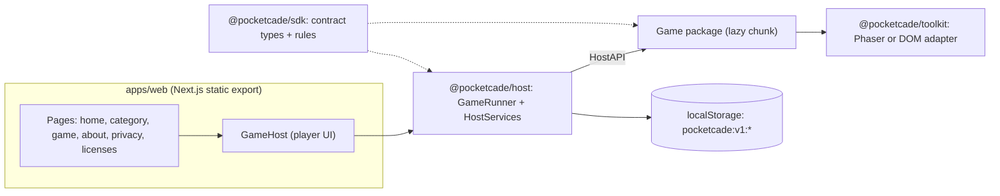

# Pocketcade design

How Pocketcade is built, as of 11 November 2026. This document describes the code as it is and is the reference for
the project. Each game's rules and art, and every place the code departed from the original specs, are in
[games-notes.md](games-notes.md); the visual language is in [design-system.md](design-system.md).

The original product specs were retired on 11 November 2026. Requirement IDs in code comments and test names
(`POR-701`, `TK-302`, `DEP-215`, `CT-04` …) are labels from those specs; the code or comment beside each one says
what it requires.

## At a glance

| Area | Choice |
| --- | --- |
| Product | 14 free browser games; no accounts, ads, analytics, cookies or third-party requests |
| Portal | Next.js 16.4.5 App Router, React 19.3.1, **static export** (`output: 'export'`, trailing slashes) |
| Games | Workspace packages behind one contract (`Game` / `HostAPI`); 13 on Phaser 4.2.1, 1 on plain DOM |
| Data | Saves, local top-10 boards, settings and play history in `localStorage`, on the device only |
| Hosting | One Vercel project serving `apps/web/out`; every header in `apps/web/vercel.json`; no functions |
| Repo | pnpm 12.18.0 workspace + Turborepo 2.11.10, Node 26, TypeScript 7 |

## Repository

| Path | Package | Role | May depend on |
| --- | --- | --- | --- |
| `packages/sdk` | `@pocketcade/sdk` | Contract types, `validateMeta`, storage and score rules (`./rules`), contract test suite (`./testing`) | nothing |
| `packages/host` | `@pocketcade/host` | `GameRunner`, `HostServices` (storage, scores, audio, fullscreen, error attribution), dev guard | sdk |
| `packages/toolkit` | `@pocketcade/toolkit` | Shared game code: loop, input, SFX synth, saves, overlays, attract mode, art helpers; `./phaser` and `./dom` adapters | sdk (Phaser as a peer) |
| `packages/games/<id>` | `@pocketcade/game-<id>` | One game: `src/meta.ts`, `src/index.ts`, `game.md`, `media/cover.svg`, tests | sdk, toolkit |
| `packages/config` | `@pocketcade/config` | Shared tsconfig, ESLint and Prettier config | — |
| `apps/web` | `@pocketcade/web` | The portal, `vercel.json`, share-image script, Playwright e2e | sdk, host, games (via the generated registry only) |
| `apps/playground` | `@pocketcade/playground` | Vite 8.3.6 app that mounts any game on the real host; leak and crash e2e | sdk, host, games |
| `tools/` | — | Build and check scripts run with plain `node` (see [Build and deploy](#build-and-deploy)) | — |

Rules enforced by lint (`tools/check-workspace.ts` and ESLint): exact versions only; games never import another game
or the host; the portal imports game packages only from `src/games/*.generated.ts`; game code cannot reach
`localStorage`, cookies, `location` or `history` directly (it goes through `host.storage`).

## The game contract

A game package default-exports a `GameDefinition`: a static `meta` and a `create()` that returns a fresh `Game` per
mount (no module-level state).

| `GameMeta` field | Meaning |
| --- | --- |
| `id`, `version`, `apiVersion` | Slug (= folder = catalog id), package semver, contract version `1` |
| `inputs`, `orientation` | `keyboard` / `pointer` / `touch`; `landscape` / `portrait` / `any` |
| `aspectRatio`, `minSize` | Frame shape the portal sizes the player to; below `minSize` the host shows a notice |
| `saveSchemaVersion` | Stamped into every save envelope |
| `leaderboards` | Local boards (id, label, format, order); may be empty |

| `Game` method | Contract |
| --- | --- |
| `mount(container, host, { signal, size, launch })` | Resolves when playable; honours `signal` (fast navigation); `launch` is `play`, `restart` or `attract` (self-playing, no writes) |
| `pause(reason)` / `resume()` | Idempotent; only the host calls them. Reasons: `visibility`, `blur`, `offscreen`, `overlay`, `user`, `host` |
| `unmount()` | Releases every loop, listener, timer, audio node, WebGL context and DOM node it created |

| `HostAPI` | What a game gets |
| --- | --- |
| `env` | Locale, reduced motion, mute, primary input, local `dailyKey`, whether storage persists |
| `storage` | Async key/value per game; never throws; ≤ 64 KiB per key, ≤ 256 KiB per game |
| `scores` | `submit` / `top` on local top-10 boards; the portal asks for initials, never the game |
| `display`, `audio` | Fullscreen request (native or pseudo); the shared `AudioContext` and a master output node |
| `gameplay` | `start`, `stop(reason)`, `loading(progress)` signals for the player UI |
| `on(event)`, `reportError` | `resize`, `mute`, `fullscreenchange`, `inputchange`, `dailyrollover`; non-fatal errors |

Storage keys: `pocketcade:v1:g:<game>:<key>` (saves), `pocketcade:v1:lb:<game>:<board>` (boards),
`pocketcade:v1:p:<key>` (portal settings and play history).

## Host

- **GameRunner** mounts one game into the player frame: 15 s mount and 2 s unmount timeouts, abort on navigation,
  and a document-wide slot so two games never run at once.
- **Pausing**: the host pauses the game when the tab is hidden, the window loses focus, the frame is under 50 %
  visible, or an overlay opens; the player resumes from the pause overlay.
- **Errors**: window errors are attributed to the mounted game (toolkit marker or the game's script URLs). A fatal
  error shows the crash card with Retry (then Reload page) and, when the repo URL is known, a prefilled GitHub
  issue.
- **Audio**: one `AudioContext` per document, a fresh master gain per mount, resumed inside the Play click.
- **Fullscreen**: the native API where available, otherwise pseudo-fullscreen (fixed stage, scroll lock).
- **Dev guard** (dev builds and playground only): records sandbox violations by game code.

## Toolkit

| Module | What it gives every game |
| --- | --- |
| `loop` | Fixed 60 Hz update, one render per frame, at most 5 catch-up steps |
| `input` | Keyboard action map by `KeyboardEvent.code`, pointer gestures (tap, swipe, drag), an input gate |
| `sfx` | Synthesized sound effects (no audio files), played through the host's output node |
| `save` | Versioned saves with migrations over `host.storage` |
| `attract` | Scripted virtual input for the self-playing demo |
| `ui/overlays` | How-to card, pause menu, game-over dialog, toasts and the HUD pause button, in a shadow root |
| `art`, `tokens`, `phaser/fx` | Palette and type tokens, canvas textures, bursts, pop text, shake, flash |
| `./phaser` | `definePhaserGame`: FIT scaling to the meta aspect ratio, lazy Phaser import, cleanup hardening for Phaser 4.2.1 |
| `./dom` | `defineDomGame` for engine-less games, with styles scoped in a shadow root |

Each game splits a pure, deterministic simulation (`sim.ts`, unit-tested) from its scene (drawing, input, sound).

## Portal

| Route | Content |
| --- | --- |
| `/` | Hero, Continue playing (on-device history), editorial rails, mood rows, categories |
| `/category/<slug>/` | The category's games, then the rest |
| `/games/<id>/` | Player, About, How to play (controls per input), Questions, More like this |
| `/about/`, `/privacy/`, `/licenses/` | Static pages; Licenses reads `ASSETS.md` at build |
| `/sitemap.xml`, `/robots.txt`, `/version.json` | Static route handlers |
| 404 | Portal page with picks; `noindex` |

- **Catalog data**: `src/games/catalog.ts` holds the portal listing per game (title, tagline, category, tags, accent,
  blurb, order). `tools/gen-registry` generates the lazy loaders (`registry.generated.ts`), each game's `meta`
  (`metas.generated.ts`) and the controls, FAQ and cover alt text from each `game.md` (`details.generated.ts`).
- **Player** (`GameHost`): poster, Play, pause overlay, notices, crash and update cards, fullscreen chrome, initials
  prompt and leaderboard sheet. React never renders inside the game frame.
- **Updates**: if a game chunk fails to load and `/version.json` reports a new build, the player offers a reload.
- **SEO**: each page sets its title, description, canonical, Open Graph and Twitter tags (`src/lib/seo.ts`). Game
  pages add `VideoGame` and `BreadcrumbList` JSON-LD. Canonicals use `NEXT_PUBLIC_SITE_URL`, else the Vercel
  production domain; previews share their own URL in share tags. Share images are `public/og/*.jpg`.
- **Performance**: Phaser ships as one shared chunk, prefetched on game pages and absent from catalog pages.
  Fonts (Fredoka, Nunito) are self-hosted from npm.

## Build and deploy

| Step | Tool |
| --- | --- |
| Generate registry, metas, details; copy covers | `tools/gen-registry.ts` (Turbo task `@pocketcade/web#catalog`) |
| Build | `next build` → `apps/web/out` |
| Post-process | `tools/postbuild.ts`: Phaser prefetch links, flat RSC segment copies, `version.json` fallback |
| Share images (manual, committed) | `pnpm og` → `apps/web/scripts/gen-og.ts` (Playwright Chromium) |
| Serve locally like Vercel | `tools/serve-static.ts` applies `vercel.json` headers and redirects |

Vercel builds with `turbo build` from Root Directory `apps/web` (settings in the [README](../README.md#deploying-to-vercel)).
`vercel.json` sets the CSP, Permissions-Policy and other security headers, immutable caching for hashed assets, and
`X-Robots-Tag: noindex` on every path until launch. Previews also serve `robots.txt` with `Disallow: /`. Every
environment variable is optional and non-secret ([.env.example](../.env.example)).

## Quality gates

| Check | Where | What it proves |
| --- | --- | --- |
| Unit tests (Vitest 5.1.0) | every package, `tools/` | Simulations, rules, toolkit, portal helpers, tools |
| Contract suite (Vitest browser mode) | every game | Mount, pause, unmount, attract and storage rules hold against the real host |
| Portal e2e (Playwright 1.65.0) | `apps/web/e2e` | Served build: every spec in Chromium (player flows, prefetch, leaks); the smoke spec (headers, routing, CSP, SEO files) also in Firefox, WebKit, Pixel 7 and iPhone 15 profiles |
| Leak e2e | `apps/playground/e2e` | 20 attract mount/unmount cycles of Sumslide (Phaser) and Letterhop (DOM) leave no listeners, timers or contexts behind; a leaking fixture must fail |
| Size budgets | `tools/check-budgets.ts`, `tools/budgets.json` | Catalog page JS ≤ 200 KB, no Phaser on catalog pages, one Phaser chunk ≤ 365 KB, each game ≤ 60 KB (gzip) |
| Lint | `pnpm lint` | Prettier, ESLint, workspace rules, env documentation, workflow pinning, generated files up to date |

CI (`.github/workflows/ci.yml`): `pr-title`, `lint`, `typecheck`, `unit`, `build`, `budgets`, `e2e`, `leak`,
`deps-review` and `ci-ok` (which needs all of them); `lhci` runs report-only.

## Games

| Game | Id | Category | Engine | Frame | Inputs |
| --- | --- | --- | --- | --- | --- |
| Sumslide | `sumslide` | Puzzle | Phaser | 1:1 | keyboard, pointer, touch |
| Letterhop | `letterhop` | Word | DOM | fills the frame | keyboard, pointer, touch |
| Bao Bolt | `bao-bolt` | Arcade | Phaser | 16:9 | keyboard, pointer, touch |
| Comet Crush | `comet-crush` | Arcade | Phaser | 4:3 | pointer, touch, keyboard |
| Firefly Flip | `firefly-flip` | Brain | Phaser | 1:1 | pointer, touch, keyboard |
| On the Dot | `on-the-dot` | Arcade | Phaser | 9:16 | keyboard, pointer, touch |
| Pentafall | `pentafall` | Puzzle | Phaser | 9:16 | keyboard, touch |
| Rowdy | `rowdy` | Cards & Board | Phaser | 7:6 | pointer, touch, keyboard |
| Sourdough Solitaire | `sourdough` | Cards & Board | Phaser | 1:1 | pointer, touch, keyboard |
| Molehills | `molehills` | Puzzle | Phaser | 1:1 | pointer, touch, keyboard |
| Glowworm | `glowworm` | Arcade | Phaser | 1:1 | keyboard, pointer, touch |
| Pop Reef | `pop-reef` | Puzzle | Phaser | 3:4 | pointer, touch, keyboard |
| Sunset Sprint | `sunset-sprint` | Arcade | Phaser | 4:3 | keyboard, pointer, touch |
| Pebble Post | `pebble-post` | Arcade | Phaser | 9:16 | keyboard, pointer, touch |

Each game's rules, art and departures from its spec are in [games-notes.md](games-notes.md).

## Not built yet

- **Portal**: `/search/` results page, `/settings/` (export, import, delete data), automatic thumbnail and preview
  capture, the `@pocketcade/catalog` package that validates `game.md`, axe checks, blocking Lighthouse CI.
- **Before launch**: name and trademark checks for the site and every game (all `game.md` files are
  `status: hidden`), a legal/IP review for Pentafall, a review of the Privacy page, tests on real phones, a domain
  (`NEXT_PUBLIC_SITE_URL`) and removing the pre-launch `noindex`.
- **Known issue**: on small frames the portal's initials banner can cover the game-over "Play again" button.
