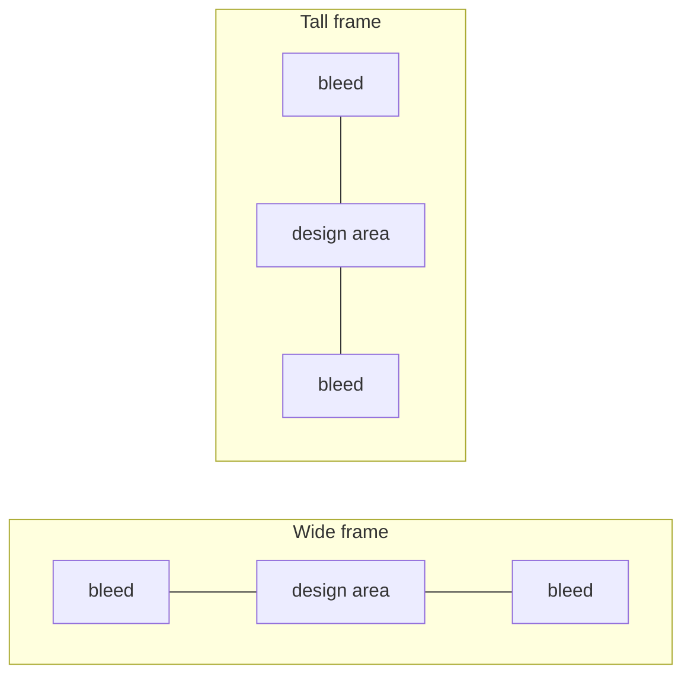

# Making games for Pocketcade

How a game package is put together, what the toolkit gives you, and the quality bar a game has to meet. The
contract itself (`Game`, `HostAPI`, `GameMeta`) is described in [architecture.md](architecture.md).

## Anatomy of a game package

```
packages/games/<id>/
  game.md            portal listing: title, tagline, category, tags, accent, controls, FAQ, blurb
  media/cover.svg    square key art (viewBox 0 0 600 600, no text, no external references, ≤ 40 KB)
  src/meta.ts        GameMeta: id, inputs, aspect ratio, minimum size, leaderboards
  src/index.ts       definePhaserGame({ meta, scenes, config }) or defineDomGame(...)
  src/sim.ts         the rules: pure and deterministic (also named logic.ts or rules.ts)
  src/scene.ts       drawing, input, sound; reads and steps the simulation
  src/art.ts         textures drawn in code
  src/attract.ts     script for the self-playing demo
  src/save.ts        save shapes and validation
  src/strings.ts     every player-facing string
  test/              unit tests for the rules, plus contract.test.ts
```

Two rules shape everything else:

1. **Rules are pure.** The simulation module takes state and input and returns state. It never touches Phaser, the
   DOM, time or `Math.random` (it receives a seeded generator from `tk.rng`). That is what makes the rules unit
   testable and the attract demo repeatable.
2. **The host owns the page.** A game draws inside the container it is given and reaches storage, audio, fullscreen
   and scores only through the host. It must pause when told, and leave nothing behind on unmount: no listeners,
   timers, audio nodes, WebGL contexts or DOM nodes. The toolkit adapters do most of this for you.

## The toolkit

| You need | Use |
| --- | --- |
| A Phaser game | `definePhaserGame` from `@pocketcade/toolkit/phaser`; scenes extend `kit.Scene` and get `this.tk` |
| A DOM game | `defineDomGame` from `@pocketcade/toolkit/dom` (styles are scoped in a shadow root) |
| Input | `tk.input`: keyboard actions by key code, pointer taps, swipes and drags, already in design units |
| Sound | The `sfx` list in the game config, played with `tk.sfx.play(name)`; every effect is synthesized |
| Saves | `tk.createSave({ key, parse, ... })`: validated on load, flushed on pause and unmount |
| Scores | `tk.host.scores.submit({ board, value })`; the portal asks for initials |
| Dialogs | `tk.ui`: how-to card, pause menu, game-over dialog, toasts, pause button |
| Textures | `kit.textures.canvas(scene, key, w, h, draw)` draws once with Canvas 2D at the render scale |
| Feedback | `burst`, `popText`, `shake`, `flash`, `bump`, `hudPill`, `backdrop` from the Phaser adapter |
| Motion preferences | `tk.motion.reduced`; the feedback helpers already honour it |

## Frames that fit any screen

`meta.aspectRatio` can be one ratio, or a range the game adapts to:

```ts
aspectRatio: { min: 9 / 16, max: 16 / 9 },
```

With a range, the portal gives the game the frame shape inside it that best fills the screen: wide on a desktop,
tall on a phone.



- `designSize` is the **design area**. Everything the player must see or touch lives inside it, at every frame
  shape. Its own shape must lie inside the range.
- When the frame is wider or taller than the design area, the camera shows extra space around it.
  `tk.layout.view` is the visible rectangle in design units (its `x` and `y` go negative when there is overhang) and
  `tk.layout.bleed` is the largest overhang the range allows on each side.
- Scenery has to cover the whole view. Draw backgrounds from `-bleed.x` to `width + bleed.x` and from `-bleed.y` to
  `height + bleed.y`. `backdrop()` does this for its gradient, glows and stars.
- A HUD may stay in the design area, or be anchored to the view's edges and repositioned on `tk.on('resize')`,
  which fires when the player rotates a phone or enters fullscreen.

## Crisp rendering

The canvas is rendered at up to twice the design size, chosen for the largest size the game can reach (including
fullscreen). Art stays sharp if it is drawn that way:

- Draw sprites with `kit.textures.canvas` at the default scale. Keep `scale: 1` for large, soft backgrounds.
- Never show a texture larger than it was drawn.
- Create text with `kit.text`; for text baked into a texture use `font()` at 14 design px or more.
- Prefer solid fills, a darker rim, one highlight and one soft shadow. Stacked glows and hairlines read as blur.
- Keep gameplay objects in strong contrast with a calmer background, and fill the design area with the playfield.

## Feel and performance

- Every meaningful action gets a response in the same frame: a pop, a small burst, a sound.
- Animation never blocks input. If a player can act faster than an effect plays, the effect yields.
- Build backgrounds in layers with slow movement, and change the scenery as the player progresses.
- Hold 60 frames per second on a mid-range phone: pool objects, allocate nothing in per-frame loops, generate
  textures at scene start, cap live particles and tweens.

## Originality

All art is drawn in code or hand-written SVG and all sound is synthesized, so a game adds no third-party assets.
Genres and mechanics are fair game; another game's name, characters, art, music or level layouts are not. If a
game does need outside data (Letterhop's word lists), record its source and licence in [ASSETS.md](../ASSETS.md).

## Seeing and checking your work

Run the playground, which mounts any game on the real host:

```bash
pnpm --filter @pocketcade/playground dev
```

Capture frames of a running game at any frame size (the playground must be running):

```bash
node apps/playground/scripts/shot.ts <id> --size 1031x580 --at 2000,6000
```

`--launch attract` (the default) records the self-playing demo; `--launch play` starts a real game and accepts
`--click "x,y;x,y"` and `--keys "Enter,ArrowLeft"`. Check a desktop frame, a phone frame and the two ends of the
game's aspect range.

Each game package has three checks:

| Check | Command (in the package folder) | What it proves |
| --- | --- | --- |
| Types and lint | `pnpm typecheck`, `pnpm lint` | The code compiles and stays inside the game sandbox rules |
| Rules | `pnpm exec vitest run --project unit` | The simulation behaves as specified |
| Contract | `pnpm exec vitest run --project contract` | In a real browser: mounts, pauses, resumes, plays attract and unmounts cleanly on the real host |

## Adding a game

1. Create `packages/games/<id>/` with the files above; copying a game of a similar kind is the quickest start.
   `meta.id` is the folder name.
2. Add `"@pocketcade/game-<id>": "workspace:*"` to the dependencies of `apps/web` and `apps/playground`, then run
   `pnpm install`.
3. Add the id to `gameOrder` in `apps/web/src/games/catalog.ts`, at the position it deserves.
4. Run `pnpm og` and commit the new share image in `apps/web/public/og/`.

`tools/gen-registry` picks up the loader, the meta, the listing from `game.md` and the cover on the next build.
